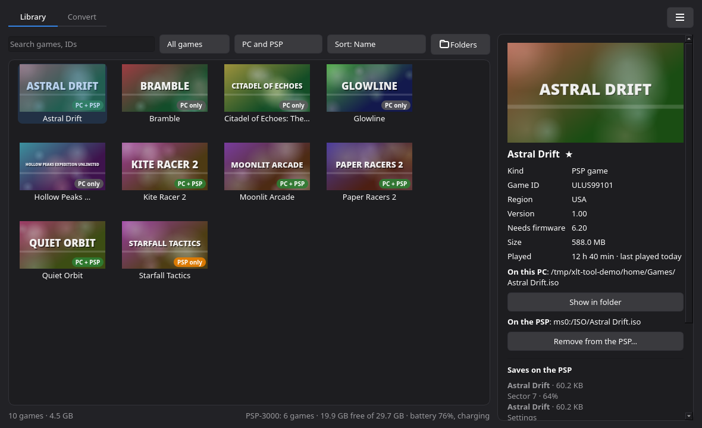
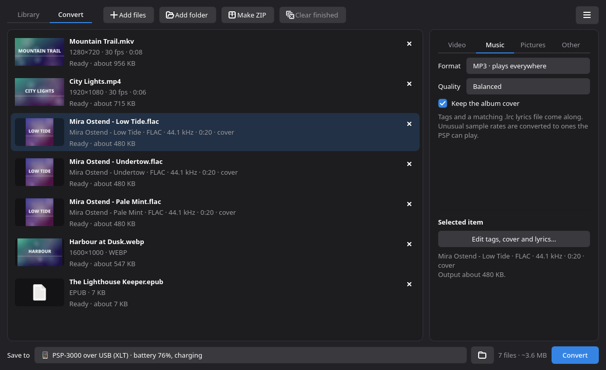
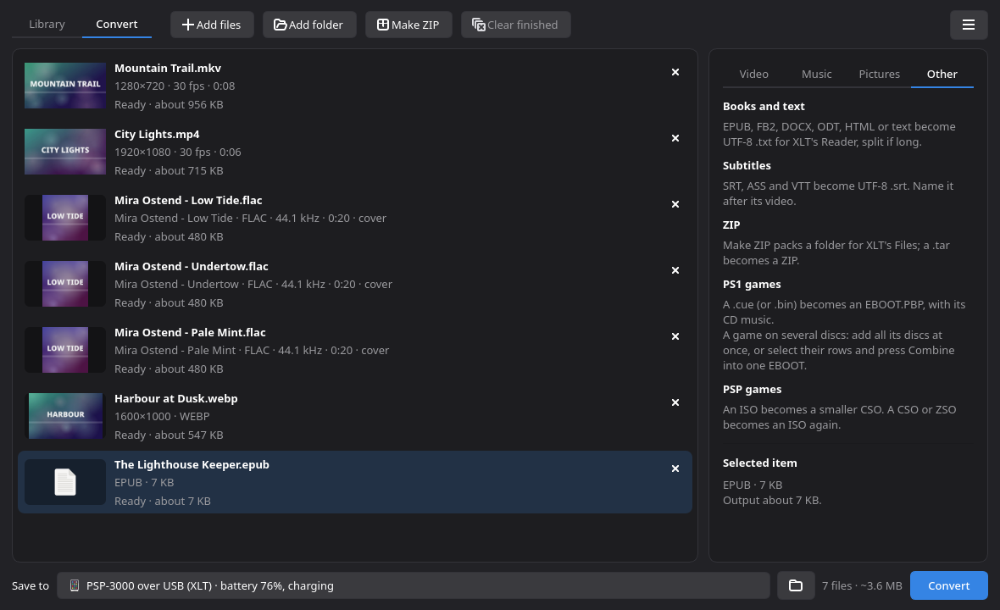
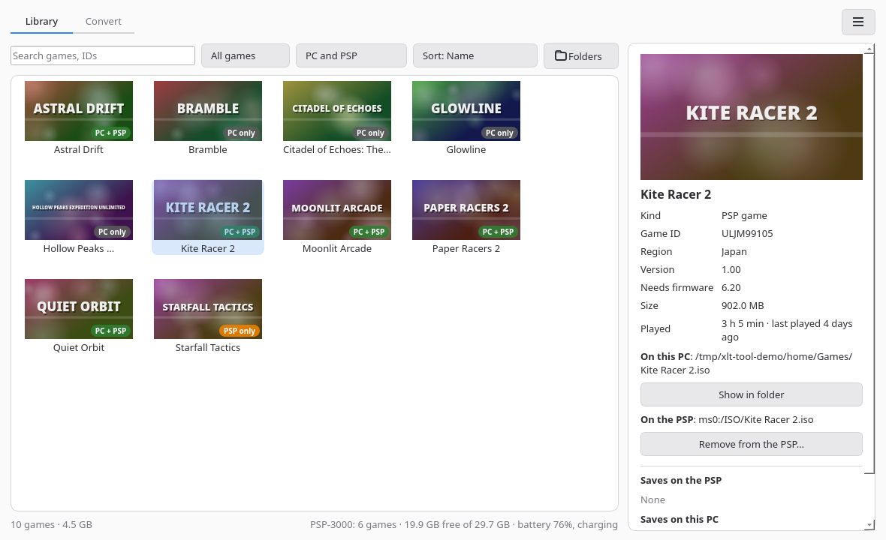

# XLT Tool

The PC companion of [XLT](https://github.com/boubounokefalos/xlt), the PSP launcher. XLT Tool keeps your PSP games
in one library, shows what is on the PSP beside what is on your PC, and turns videos, music, pictures, books and
PS1 games into files the PSP plays, sending them straight to a PSP running XLT over USB, with no USB mode, while
XLT keeps running.

**The walk-through** ([`docs/media/xlt_tool_demo.mp4`](docs/media/xlt_tool_demo.mp4), no sound)

> Everything in the screenshots and videos is made up: the games, their art, the songs and the PSP are invented
> and drawn by `tools/make_demo_media.py` from XLT Tool's real window, so none of it belongs to anyone.

## What it does

- **Game library.** Your PSP games on the PC (ISO, CSO, ZSO, homebrew, PSN and PS1 EBOOTs) with their icons,
  backgrounds and details, read from the games themselves. Search, filter and sort; save backups kept per game.
- **What's on the PSP.** With XLT connected, the PSP's games appear beside the PC's: **PC + PSP**, **PSP only**
  or **PC only**, its free space and battery, and how long you've played each game and when.
- **Send, copy and remove games, with their saves.** Send a game to the PSP, copy one from it, or remove it.
  Saves are always backed up to the PC first, and put back without ever leaving half of one.
- **Convert for the PSP.** Any video to MP4 the PSP plays (with subtitles and an XMB thumbnail), music to MP3,
  M4A or FLAC with tags, covers and lyrics, pictures to JPEG or PNG, books to text, subtitles to SRT, folders to
  ZIP.
- **PS1 games to EBOOT.** A `.cue` becomes an EBOOT.PBP the PSP runs, with its icon, CD music and up to five
  discs in one. ISO games can be shrunk to CSO.
- **Straight to the PSP.** Over XLT's USB sync, each file goes where XLT looks for it while the next one
  converts; or to a Memory Stick, or any folder.
- **XLT Cast: your PSP game on the PC.** The game you're playing on the PSP, live in a window with its sound,
  over the same USB cable: full screen, sharp pixels, screenshots.
- **The PSP's folders, from the PC.** The **Files** tab shows XLT's folders on the PSP (videos, music, pictures,
  books, downloads, ISO, PSP/GAME and the saves): send files or whole folders, copy them to the PC, rename, make
  folders, delete. Saves are backed up before they are deleted.
- **Internet for the PSP over the cable.** The **Internet** button makes the PC the PSP's router, with
  [USBNet](https://github.com/chriopter/pspkit-usbnet) by chriopter, which XLT Tool downloads and sets up.
- **Update XLT over USB.** **⋮ → Update XLT on the PSP** sends the latest XLT to the PSP, with no Wi-Fi.
- **Box art** for PSP and PS1 games from the libretro project, only if you turn it on.
- **Fits your desktop.** Follows light and dark mode, the accent colour and the font (GNOME, KDE Plasma,
  Windows and others), uses your file dialogs, and tells you about new versions (the AppImage updates itself).

## Screenshots

| | |
|---|---|
|  |  |
| The Library with the PSP connected: badges, details, play time, saves | A game only on the PSP, right-clicked |
|  |  |
| The Convert queue, sending to the PSP over USB | Music settings |
|  |  |
| Editing a song's tags, cover and lyrics | Books, subtitles, ZIP, PS1 and PSP games |

## Getting started

1. Download `XLT_Tool-<version>-x86_64.AppImage` from the [releases](https://github.com/boubounokefalos/xlt-tool/releases)
   (on Windows, see [below](#on-windows)),
   make it executable (`chmod +x`, or in its Properties), and start it. **⋮ → Add to applications menu** adds it
   to your desktop's menu.
2. For the Library, choose **Folders** and add the folders where you keep your games.
3. To send to the PSP over USB: in XLT, turn on **Settings → XLT → USB sync** and plug the cable in. The PSP shows
   up under **Save to**. The first time, pick **PSP over USB: allow access…** there and give your password once.
   (A Memory Stick in a card reader, or the PSP in USB mode, shows up there too.)
4. Drop files on the **Convert** tab, check each kind's settings, and press **Convert**.

It runs on x86-64 Linux distros with glibc 2.34 or later (Ubuntu 22.04+, Debian 12+, Fedora 35+, Arch, openSUSE
Tumbleweed…), on X11 or Wayland. It needs nothing else installed: Python, Qt, ffmpeg and the ATRAC3 encoder are
inside. Making PS1 EBOOTs needs one PS1 EBOOT of your own, once (XLT Tool copies Sony's small start-up parts
from it, as it can't include them).

### On Windows

> ⚠️ **Smart App Control must be off.** XLT Tool isn't signed, and Windows 11's Smart App Control blocks unsigned
> programs completely: with it on, the installer and the app won't start at all, and there is no exception for
> one app. Check it in **Windows Security → App & browser control → Smart App Control**: if it says **On** or
> **Evaluation**, set it to **Off** before installing. Many PCs have it off already (Windows 10 has none).
> Turning it off is your choice, and turning it back on afterwards isn't always possible without reinstalling
> Windows; Microsoft Defender keeps protecting the PC either way.

Download `XLT_Tool-<version>-windows-x64-setup.exe` from the releases page and run it. It installs for you alone
(no administrator password) and adds XLT Tool to the Start menu; ffmpeg and the ATRAC3 encoder are inside. For
USB sync nothing else is needed: Windows sets the PSP up by itself the first time. The `.zip` is the same app,
portable: unzip it anywhere and start `XLT Tool.exe`. It runs on Windows 10 and 11, 64-bit.

XLT Tool isn't signed (it is a free, community-built tool), so Windows
treats it as unknown:

- **"Windows protected your PC"** (SmartScreen) shows when you start the downloaded installer: choose
  **More info**, then **Run anyway**. Once installed, XLT Tool starts without it.
- **Smart App Control** (Windows 11): blocks it, see above.
- If an antivirus, Windows Defender included, says XLT Tool is a threat, that's a false positive common to
  unsigned Python programs. You can send the file to [Microsoft](https://www.microsoft.com/en-us/wdsi/filesubmission)
  to have it checked; please [open an issue](https://github.com/boubounokefalos/xlt-tool/issues) too.

## XLT Cast: the PSP's game on the PC

Press **Cast** at the top of XLT Tool and the game you're playing on the PSP shows in a window, live and with its
sound, over the same USB cable. To set it up, turn on **Settings → XLT → XLT Cast** in XLT once. Then, in a game,
with the cable in, **L+R+SELECT** starts or stops casting, and **HOME** stops it too.

- **Picture:** 480×272 as the PSP draws it, as big as the window allows. **Sharp pixels** keeps every PSP pixel
  square, in whole steps; double-click or **F11** for full screen, **Ctrl+S** for a screenshot (saved at
  480×272 in Pictures/XLT Cast).
- **Sound:** the game's own, with a volume slider and mute.
- **Speed:** most games come through at their own speed (30 fps for most 3D games), and the game on the PSP keeps
  its speed. Games in 32-bit colour, and homebrew ports that already use the whole PSP, are slower; for those,
  **Every other frame** keeps the game on the PSP smooth, at half the frames on the PC.
- **PS1 games:** the picture, no sound yet (with XLT 1.4.0 or later).
- **What it can't cast:** XLT itself; and games that use USB themselves (camera, GPS). USB sync and Cast take
  turns: sync comes back when casting stops.

On Linux it uses the same access as USB sync; on Windows, Windows sets it up by itself the first time. How it
works: [XLT Cast](docs/Cast.md).

## Internet for the PSP over USB

With XLT 1.4.0 or later, the PSP can use the PC's internet through the USB cable, with
[USBNet](https://github.com/chriopter/pspkit-usbnet) by chriopter (MIT). XLT Tool downloads USBNet's latest
release from GitHub (checked against GitHub's SHA-256) and keeps it up to date.

1. In XLT, turn on **Settings → Network → Internet over USB**. With the PSP on USB sync, press **Internet** in XLT
   Tool once: if USBNet isn't on the PSP yet, XLT Tool sends it and XLT installs it at its next start (a USBNet
   you installed yourself, with PSPDX for instance, is left as it is).
2. Keep **Internet** pressed in XLT Tool while the PSP is online. On the PSP, connect to **Hi-Speed USB**.

USB sync and the internet share the cable: inside XLT, sync waits while the browser is online over USB and comes
back when it closes. On Linux it uses the same access as USB sync. On Windows it runs out of sight too; only the
first time, when Windows has no driver for the PSP's USBNet device yet, it opens a window of its own and installs
the driver there (Windows asks first).

## USB sync or USB mode?

XLT Tool sends to the PSP over XLT's **USB sync**. The PSP's own USB mode works too (the stick shows up under **Save to** like any Memory Stick), but USB sync does more:

| | **USB sync** (XLT Tool) | **USB mode** (the PSP as a USB drive) |
|---|---|---|
| While connected | XLT keeps running: play music, browse, even start a game | The PSP shows "USB connected" and nothing else works |
| New files in XLT | Appear by themselves a moment after the last one | Only after you leave USB mode and XLT looks again |
| A cable pulled mid-copy | Nothing half-written is left: a file only appears once it is whole and its checksum matches | A broken file stays on the stick |
| File names | Always ones the PSP can show (Japanese, accents and all) | The PC writes them its way; a name the PSP can't hold makes the file unreachable |
| What the PC can change | Only XLT's folders and save data, never system files or plugins | The whole Memory Stick |
| Games and saves | XLT Tool shows what's on the PSP, sends and removes games, backs up and restores saves, shows the battery | Copy files by hand |
| Speed (64 MB) | 8.3 MB/s | 9.6 MB/s |
| On the PC | XLT Tool (Linux: allow access once; Windows: nothing to set up) | Any file manager, no software |

USB sync suits everyday use: sending a few videos or songs, or adding a game, without leaving XLT. USB mode is
still in XLT's control center for anything else, such as copying a whole folder tree or reaching files outside
XLT's folders.

How it works: [Sending to the PSP over USB](docs/USB-Sync.md), and XLT's [USB sync, in depth](https://github.com/boubounokefalos/xlt/blob/main/docs/USB-Sync.md).

## How it was made

XLT Tool is **vibe-coded**, like XLT: written with **Claude** (Anthropic's AI model) in
[Claude Code](https://claude.com/claude-code). The author described what it should do, chose between the options
Claude proposed, and tried every step in the real app and on a real PSP (a PSP-E1004 with ARK-5); Claude wrote the
code, the tests and these docs. Like any homebrew tool, it comes with no warranty.

## For developers

XLT Tool is Python 3 with PySide6 (Qt 6); ffmpeg and atracdenc do the heavy conversions. Run it from source with
`./run-dev.sh`, build the AppImage with `./packaging/build-appimage.sh`, run the tests with
`python3 -I -m unittest discover -s tests`. How each part works, the formats it writes and how it is tested are in
the **[developer docs](docs/Home.md)**.

## Credits

XLT Tool is free software under the **GPL-3.0** (see [LICENSE](LICENSE)). It shares code with
[XLT](https://github.com/boubounokefalos/xlt) (the USB sync client, the logo and boot screen), and the AppImage
and the Windows build bundle, each under its own licence:
[Python](https://www.python.org/) (via [python-build-standalone](https://github.com/astral-sh/python-build-standalone)),
[Qt 6 and PySide6](https://doc.qt.io/qtforpython/) (LGPL-3.0),
[FFmpeg](https://ffmpeg.org/) ([BtbN's GPL build](https://github.com/BtbN/FFmpeg-Builds)),
[atracdenc](https://github.com/dcherednik/atracdenc) (LGPL-2.1),
[mutagen](https://github.com/quodlibet/mutagen) (GPL-2.0+),
[pyusb](https://github.com/pyusb/pyusb) and [libusb](https://libusb.info/),
[jeepney](https://gitlab.com/takluyver/jeepney) (MIT); the Windows build is packed with
[PyInstaller](https://pyinstaller.org/) and its installer made with [Inno Setup](https://jrsoftware.org/isinfo.php).
The PS1 EBOOT layout follows what [pop-fe](https://github.com/sahlberg/pop-fe) writes; box art comes from
[libretro-database](https://github.com/libretro/libretro-database) and
[libretro-thumbnails](https://github.com/libretro-thumbnails); the Internet button downloads and runs
[USBNet](https://github.com/chriopter/pspkit-usbnet) by chriopter (MIT). The full list, with what each is used for:
**[License and credits](docs/Credits.md)**.

## Trademarks

PlayStation, PSP, PlayStation Portable, UMD, XMB and POPS are trademarks of Sony Interactive Entertainment Inc.;
Memory Stick and ATRAC3 are trademarks of Sony Group Corporation. Windows is a trademark of Microsoft. Claude
and Claude Code are trademarks of
Anthropic. XLT Tool is an independent, unofficial project, not affiliated with or endorsed by Sony or the ARK
developers, and contains no Sony software.
