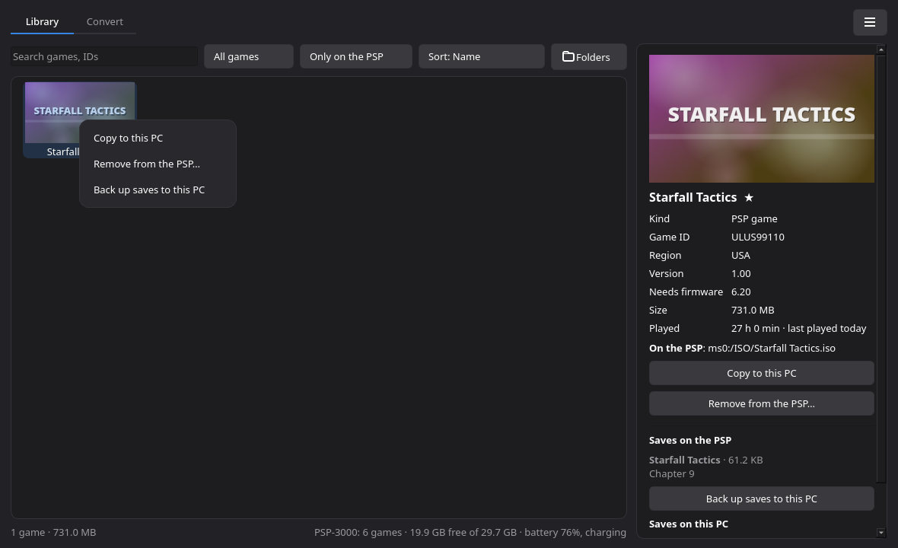
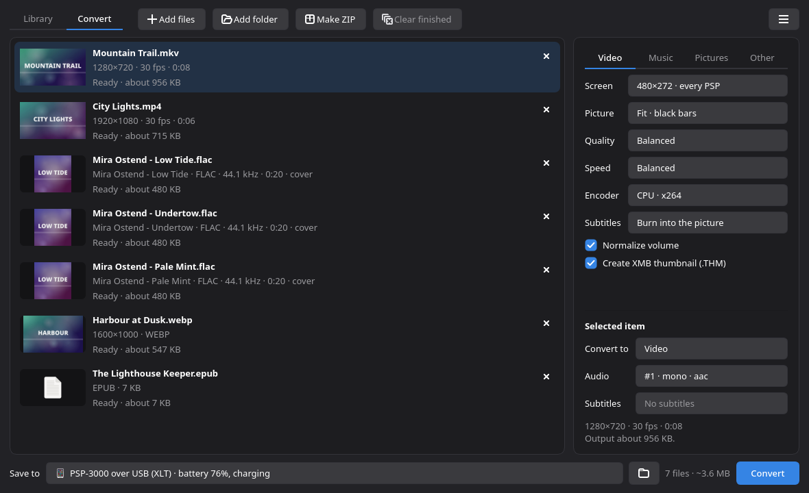
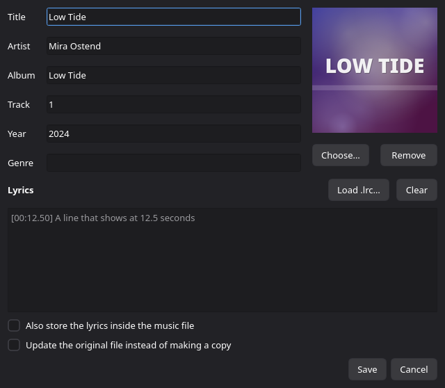

# XLT Tool

The PC companion of [XLT](https://github.com/boubounokefalos/xlt), the PSP launcher. XLT Tool keeps your PSP games
in one library, turns videos, music, pictures, books and PS1 games into files the PSP plays, and sends them
straight to a PSP running XLT over USB, while XLT keeps running.

**[Watch XLT Tool on YouTube](https://youtu.be/Evb9TZlb8BA)** · **[Download the latest release](https://github.com/boubounokefalos/xlt-tool/releases/latest)**

> The games, art, songs and PSP in the screenshots and video are made up, drawn from XLT Tool's real window.

## Features

- **Game library:** ISO, CSO, ZSO, homebrew, PSN and PS1 games, with their icons, details and play time. See what's
  on the PSP beside what's on the PC.
- **Send, copy and remove games with their saves.** Saves are always backed up to the PC first.
- **Convert for the PSP:** video to MP4 (with subtitles and a thumbnail), music to MP3, M4A or FLAC with tags,
  covers and lyrics, pictures, books, subtitles and ZIPs.
- **PS1 games to EBOOT**, with their icon, CD music and up to five discs, and **ISO to CSO**.
- **Straight to the PSP** over XLT's USB sync, or to a Memory Stick or any folder.
- **Files tab:** browse and change XLT's folders on the PSP from the PC.
- **XLT Cast:** the game you're playing on the PSP, live in a window with its sound: full screen, sharp pixels,
  screenshots.
- **Internet for the PSP over the cable**, with [USBNet](https://github.com/chriopter/pspkit-usbnet) by chriopter.
- **Update XLT over USB**, no Wi-Fi needed.
- **Box art** from the libretro project, only if you turn it on.
- **Fits your desktop:** light and dark mode, your accent colour and font, and it updates itself.

## Screenshots

| | |
|---|---|
|  |  |
| The Library with the PSP connected | A game only on the PSP |
|  |  |
| Converting and sending over USB | Editing a song's tags, cover and lyrics |

## Getting started

1. Download it from the [releases](https://github.com/boubounokefalos/xlt-tool/releases/latest):
   - **Linux:** `XLT_Tool-<version>-x86_64.AppImage`. Make it executable (`chmod +x`) and start it;
     **⋮ → Add to applications menu** adds it to your menu. Any x86-64 distro with glibc 2.34 or later (Ubuntu
     22.04+, Debian 12+, Fedora 35+, Arch…), on X11 or Wayland.
   - **Windows 10 and 11 (64-bit):** `XLT_Tool-<version>-windows-x64-setup.exe` (no administrator needed), or the
     portable `.zip`. See [the note on Windows](#on-windows) first.
2. In XLT on the PSP, turn on **Settings → XLT → USB sync** and plug the cable in. On Linux, pick **PSP over USB:
   allow access…** under **Save to** once; on Windows there is nothing to set up.
3. For the Library, choose **Folders** and add where you keep your games. To convert, drop files on **Convert** and
   press **Convert**.

Everything it needs (Python, Qt, ffmpeg, the ATRAC3 encoder) is inside. PS1 EBOOTs need one PS1 EBOOT of your own,
once: XLT Tool copies Sony's small start-up parts from it, as it can't include them.

**On the PSP:** XLT Cast needs **Settings → XLT → XLT Cast**, then **L+R+SELECT** in a game. Internet needs
**Settings → Network → Internet over USB**, the **Internet** button pressed, and a connection to **Hi-Speed USB**.

### On Windows

> ⚠️ **Smart App Control must be off.** XLT Tool isn't signed (it is a free, community-built tool), and Windows
> 11's Smart App Control blocks unsigned programs completely. Check **Windows Security → App & browser control →
> Smart App Control**: if it says **On** or **Evaluation**, set it to **Off** before installing. Many PCs have it
> off already, and Windows 10 doesn't have it. Turning it back on later isn't always possible without
> reinstalling Windows; Microsoft Defender keeps protecting the PC either way.

When you start the installer, **"Windows protected your PC"** shows once: choose **More info → Run anyway**. If an
antivirus flags XLT Tool, that's a false positive common to unsigned Python programs; please
[open an issue](https://github.com/boubounokefalos/xlt-tool/issues) and send the file to
[Microsoft](https://www.microsoft.com/en-us/wdsi/filesubmission).

## How it was made

XLT Tool is **vibe-coded**, like XLT: written with **Claude** (Anthropic's AI model) in
[Claude Code](https://claude.com/claude-code). The author decided what it should do and tried every step on a real
PSP; Claude wrote the code, the tests and the docs. It comes with no warranty.

## For developers

Python 3 with PySide6 (Qt 6), with ffmpeg and atracdenc for the heavy work. `./run-dev.sh` runs it from source,
`./packaging/build-appimage.sh` builds the AppImage, `python3 -I -m unittest discover -s tests` runs the tests.
How every part works: the **[developer docs](docs/Home.md)**, including [USB sync](docs/USB-Sync.md) and
[XLT Cast](docs/Cast.md).

## Credits

XLT Tool is free software under the **GPL-3.0** (see [LICENSE](LICENSE)), and shares code with
[XLT](https://github.com/boubounokefalos/xlt).

- **Bundled**, each under its own licence: [Python](https://www.python.org/) (via
  [python-build-standalone](https://github.com/astral-sh/python-build-standalone)),
  [Qt 6 and PySide6](https://doc.qt.io/qtforpython/) (LGPL-3.0), [FFmpeg](https://ffmpeg.org/)
  ([BtbN's GPL build](https://github.com/BtbN/FFmpeg-Builds)), [atracdenc](https://github.com/dcherednik/atracdenc)
  (LGPL-2.1), [mutagen](https://github.com/quodlibet/mutagen) (GPL-2.0+), [pyusb](https://github.com/pyusb/pyusb),
  [libusb](https://libusb.info/) and [jeepney](https://gitlab.com/takluyver/jeepney) (MIT). The Windows build is
  packed with [PyInstaller](https://pyinstaller.org/) and [Inno Setup](https://jrsoftware.org/isinfo.php).
- **Downloaded when used:** [USBNet](https://github.com/chriopter/pspkit-usbnet) by chriopter (MIT) for the
  Internet button; box art from [libretro-database](https://github.com/libretro/libretro-database) and
  [libretro-thumbnails](https://github.com/libretro-thumbnails).
- **Reference:** the PS1 EBOOT layout follows what [pop-fe](https://github.com/sahlberg/pop-fe) writes.

Everything in detail: **[License and credits](docs/Credits.md)**.

## Trademarks

PlayStation, PSP, UMD, XMB and POPS are trademarks of Sony Interactive Entertainment Inc.; Memory Stick and ATRAC3
are trademarks of Sony Group Corporation; Windows is a trademark of Microsoft; Claude and Claude Code are trademarks
of Anthropic. XLT Tool is an independent, unofficial project, not affiliated with or endorsed by Sony or the ARK
developers, and contains no Sony software.
